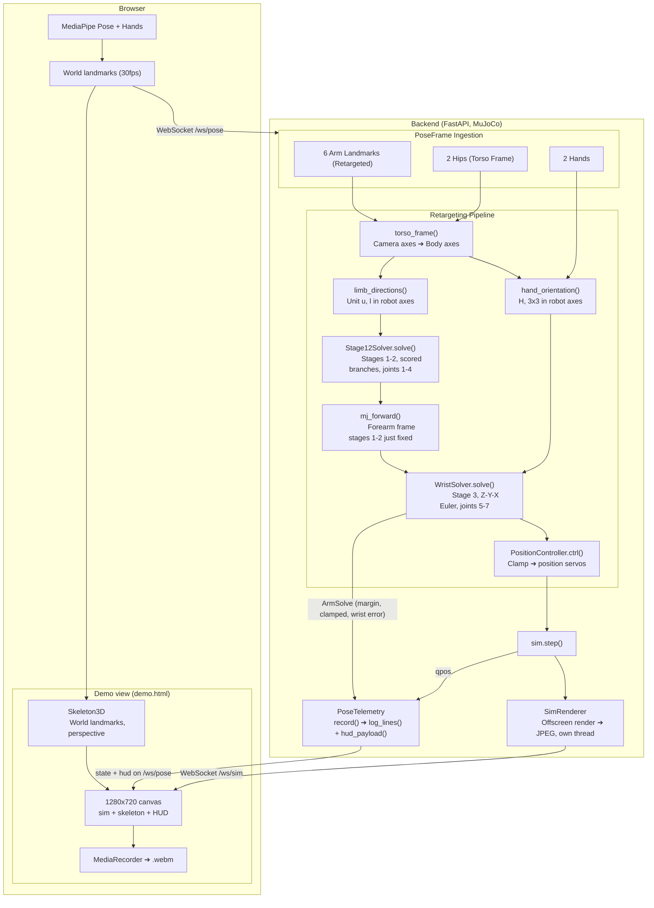

# Webcam to Bimanual Arm Human Pose Retargeting

Track human pose using webcam and drive a bimanual OpenArm in MuJoCo in real time. 

The browser runs MediaPipe and streams landmarks over a websocket; the backend holds one shared MuJoCo sim, retargets each frame to joint targets, and simulate steps.

## Solution

We represent the human limb vectors (upper arm, forarms and wrists) as unit vectors inferred from S-E-W coordinates (Shoulder, Elbow, Wrist) projected in Robot's torso frame. We then solve for maximum pose similarity by solving for robot joint angles with respect to the recorded limb vectors.

We primarily divide the problem into perception, retargeting, IK, filtering stages.

- **Perception**: Use RGB webcam and Mediapipe Posture + Hands to track Human pose. We use MediaPipe's **world** landmarks ([`socket.ts`](frontend/src/pose/socket.ts)), not the normalized image ones since those are divided by frame width and height separately, so on a 4:3 capture every direction taken from them is tilted toward vertical.
- **Retargeting**: We build a base frame (*torso frame*) from shoulders and hips, project both limb directions in it, and hand those to the robot as-is. Projecting the vectors in torso frame fixes the direction ambiguity, and enable estimation of depth. Working body-centric is what makes the result invariant to the operator turning or leaning ([`mapper.py`](backend/app/retarget/mapper.py)).
- **IK**: Closed-form [SEW-Mimic](https://arxiv.org/abs/2602.01632) solves all seven joints directly, with no Jacobian, no iteration and no solver ([`sew.py`](backend/app/retarget/sew.py)). Stages 1-2 take the two limb directions to joints 1-4; stage 3 takes the hand orientation to joints 5-7. We also evaluate damped least squares on the end-effector site, which can be experimented with using `RETARGET_MODE=ik` ([`ik.py`](backend/app/retarget/ik.py)).
- **Filtering**: The two shoulder rolls stop being observable at the singularities, i.e. arm straight, or raised out to the side - so each measured angle is weighted by how observable it is and unobservable ones relax toward the rest posture rather than tracking noise. The wrist has no such singularity (see [Assumptions](#assumptions)) but its *input* comes and goes, so a lost hand holds briefly and then eases back to rest.

Why orientation based approach:
- Invariant to teleoperator's and robot's size. Directions are more robust to scale mismatch. OpenArm v2's upper arm to forearm ratio is 1:1.40 against a human's 1:0.78, so no scaling matches wrist *and* elbow position at once.
- Sew-Mimic provides closed-form IK solution that doesn't require Jacobian and doesn't suffer from numerical instabilities around singularities.
- Enables an optimal geometric solution built from [Paden-Kahan](https://en.wikipedia.org/wiki/Paden%E2%80%93Kahan_subproblems) subproblems, and on OpenArm specifically, every one of them degenerates into trigonometry, so no subproblem solver is needed at all.
- With orientation-based retargeting, relative depth can be estimated using limb length. Direction vector (Upper Arm and Forearm) along with the length magnitude gives wrist and elbow 3D position.

Why Mediapipe for landmark detection?
- Inexpensive, runs on browser with no additional hardware required.
- Reliable and versatile. A single solution can be used for Pose and Hand landmarks.

## Demos

Demonstrations highlighting retargeting performance and edge-case behavior across all joints. Recorded from the [demo view](#demo-view); the recordings are hosted as release/PR attachments rather than committed, to keep the repo clone small.

1. **Basic Movements**: Smooth retargeting during zig-zag trajectories and full-extension arm singularities.

<!-- demo:movement -->

2. **Wrist Tracking**: Wrist orientation across dynamic poses (noticeable jitter at ~32s stems from noisy landmark estimation).

<!-- demo:wrists -->

3. **Occlusion & Singularities**: Tracking degradation under partial landmark visibility, with immediate recovery upon full re-detection.

<!-- demo:singularity -->

4. **Depth Perception**: Motion limits when moving hands along the camera's depth axis, a known disadvantage of RGB cameras.

<!-- demo:depth -->


## Assumptions

Every one of these is a property of the OpenArm v2 model, not a modelling choice, and corresponds to the assumptions present in the Sew-Mimic approach.

1. Consecutive joints axes are mutually perpendicular.
2. Joint 3's axis is collinear with the upper arm; joint 5's with the forearm.
3. No `<body>` in the arm chain for openarm has a `quat`. This means that every $R_{\text{local}}$ is identity, so the chain is a plain product of elementary rotations — this is what collapses all three stages to trigonometry.
4. Joint 7's axis is perpendicular to the gripper approach. Gripper approach is along `z` axis while J7's axis is along `x`. This means we have to use Euler decomposition to find the joint angles 5, 6, 7 (Appendix C).
5. The operator's hips are visible. [Torso frame](#input) is constructed using hips and shoulder axis from landmarks. If not visible, base frame falls back to the camera frame.

### OpenArm v2 joint axes

Axes are in each joint's own frame at `qpos=0`, where every link frame is axis-aligned with the base (assumption 2). The two arms differ in exactly three places: the axes of joints 1 and 6, and the ranges of joints 1 and 2, which mirror.

| Joint | Role                    | Axis (L) | Axis (R) | Range, L (°) | Range, R (°) |
| ----- | ----------------------- | -------- | -------- | ------------ | ------------ |
| 1     | Shoulder yaw            | `y`      | `-y`     | −200 … 80    | −80 … 200    |
| 2     | Shoulder pitch          | `-x`     | `-x`     | −190 … 10    | −10 … 190    |
| 3     | Shoulder roll (humeral) | `-z`     | `-z`     | ±90          | ±90          |
| 4     | Elbow pitch             | `-y`     | `-y`     | 0 … 140      | 0 … 140      |
| 5     | Forearm roll            | `-z`     | `-z`     | ±90          | ±90          |
| 6     | Wrist pitch             | `-y`     | `y`      | ±45          | ±45          |
| 7     | Wrist yaw               | `x`      | `x`      | ±90          | ±90          |

> [!tip]
> - Joint 5 turns about the forearm and joint 6 pitches the hand, not the reverse. Verified by perturbing each joint and watching the end effector's approach axis.
> - Joints 3 and 5 are the two *roll* axes: turning either leaves the end effector's approach direction exactly where it was and only spins the frame about it. That is precisely what makes them the limb-direction proxies of assumption 2.

## Retargeting

We follow SEW-Mimic's Algorithm 1: three stages, run in sequence, each solved in closed form. What the paper does with Paden–Kahan subproblems, OpenArm's geometry lets us do with trigonometry. See [Assumptions](#assumptions).

The objective, for reference:

$$
\min_{\boldsymbol{q}}   \underbrace{\mu_c(\boldsymbol{u}, R^{0,3}(\boldsymbol{q})·h_3)^2}_{\text{upper arm}}  +  \underbrace{\mu_c(\boldsymbol{l}, R^{0,5}(\boldsymbol{q})·h_5)^2}_{\text{forearm}}  +  \underbrace{\mu_m(T(\boldsymbol{q}), H)^2}_{\text{wrist}}
$$

such that $\boldsymbol{q}$ obeys [joint limits](#openarm-v2-joint-axes). $\mu_c,\mu_m$ are vector and matrix orientation error respectively.

### Input

We map each arm coordinates from camera frame to the operator's **torso frame** ([`mapper.py`](backend/app/retarget/mapper.py)):

```
u = unit(elbow  − shoulder)     upper arm direction
l = unit(wrist  − elbow)        forearm direction
H = hand orientation            3×3, from wrist + three knuckle landmarks
```

The torso frame is built from the shoulders and hips (`y` across the chest, `z` up the spine, `x` out of it). A direction in the human's torso frame is then *taken to be* the same direction in the robot's, and it needs no matrix. It is also what makes the result invariant to the operator turning or leaning.

Working with only directions allows the solution to ignore positions or lengths of the operator and camera.

### Stage 1: upper arm (joints 1, 2)

Rotate joints 1 and 2 until joint 3's axis points along `u` (upper arm direction). In general this is Subproblem 2, the intersection of two cones; here it inverts directly using [Rodrigues' formula](https://en.wikipedia.org/wiki/Rodrigues'_rotation_formula):

$$
\begin{aligned}
\boldsymbol{u} &= (\text{sx}\cdot\sin q_1\cdot\cos q_2,  −\sin q_2,  −\cos q_1\cdot\cos q_2) & \\ 
\text{where sx} &= −1 \text{ for left, } +1 \text{ for right}
\end{aligned}
$$

Two cones intersect in **two** rays, so there are two solution branches (`±cos q₂`) and both can be inside the joint limits.

### Stage 2: forearm (joints 3, 4)

Same machinery one link down: rotate joints 3 and 4 until joint 5's axis points along $\boldsymbol{l}$. With $A = R(h_1,q_1)\cdot R(h_2,q_2)$ and $\boldsymbol{v} = A^{\top}\cdot l$:

$$
\boldsymbol{v} = (\cos q_3\cdot\sin q_4,  -\sin q_3\cdot\sin q_4,  −\cos q_4)
$$

### Stage 3: hand (joints 5, 6, 7)

First, what the joints have to deliver. Read right to left as *peel the constants off the goal*:

$$
R^{0,7}_{\text{des}} = H \cdot R_{\text{align}}^{\top} \cdot [R^{7,\boldsymbol{T}}_{\text{local}}]^{\top}
$$

The goal is that the **tool** frame sit where the hand is. The tool frame is joint 7's frame plus a fixed axis relabelling ($R_{\text{align}}$) and a fixed mount ($R^{7,\boldsymbol{T}}_{\text{local}}$), so stripping both off leaves what the joints must produce. On OpenArm **both are identity**.

- $R^{7,\boldsymbol{T}}_{\text{local}}=\boldsymbol{I}$: the control point site carries no rotation and sits on joint 7's origin.
- $R_{\text{align}}=\boldsymbol{I}$: [`hand_orientation()`](backend/app/retarget/mapper.py) is written to emit `H` in the robot's own end-effector convention (`x` dorsal, `z` back along the approach). The alignment was paid for in the perception layer instead of carried as a matrix.

Then express it relative to the frame $R^{4,7}$ that stages 1,2 fixed, and decompose. Because every $R_{\text{local}}$ is identity, the wrist is a product of three elementary rotations:

$$
\begin{aligned}
R^{4,7} &= R_z(−q_5) \cdot R_y(s\cdot q_6) \cdot R_x(q_7)   \\
\text{where }s &= −1 \text{ left}, +1 \text{ right}
\end{aligned}
$$

so an intrinsic **Z-Y-X Euler decomposition** recovers the three angles. The signs are read off the model's own joint axes at startup.

### Safeguards

Sew-Mimic algorithm gives a closed-form solution to the retargeting solver for upper-body humanoid using a general version of Paden-Kahan subproblems. Some of the subproblems output two solutions (particularly SP2). Branch choice then, becomes crucial to account for irregular movements and erratic behaviour.

- **Branch choice**: Stage 1-2, both provide 2 solutions. Both branches are scored by checking which branch points to the consolidate *arm* direction, and selected only when the branch switch threshold is crossed. Particularly used to select `q2` and `q4` joint angles.
- **Which turn of an angle to command.** Joint 1's range is $[-3.491, 1.396]$ rad, so an angle and its ±2π twin are not interchangeable, and interpolating along the shortest arc between two reachable angles can leave the range. We find the nearest turn to the raw measurement, then interpolate, and then clamp.
- **Singular bands sized for sensor noise, not for exact degeneracy.** At singularities `q1` and `q3` can be out of reach due to `q₁` is divided by `|cos q₂| -> 0` and `q₃` by `|sin q₄| -> 0`. Putting a hard threshold adds a discontinuity exactly where the measurement is noisiest, so instead each angle is weighted by a smooth shrinkage `s²/(s²+floor²)`. If an unobservable angles is found, the angle is pulled toward the rest posture.
- **Wrapped angles at a joint stop** (stage 3). `q₅` and `q₇` come from `arctan2`, and an `arctan2` angle wraps *while out of range*. at the far side both stops are equally close and equally wrong, so a plain clamp slams the wrist 180°.
- **Missing hand**: Since MediaPipe Hands drops out constantly where the pose model does not, so we added a hold delay. The wrist holds through a certain amount of dropout lag before easing toward rest.

## Architecture



The pose path is the same either way; the demo view adds a second read of the *same* sim. `SimRenderer` runs on its own thread and only while a `/ws/sim` client is connected, and `PoseTelemetry` takes each frame once and renders it twice — to the backend log, and to the HUD payload that rides back on `/ws/pose`.

### Running

```bash
just install && just dev
```

`just dev` runs the backend with a MuJoCo viewer plus the Vite dev server; open the printed URL in a real browser, since it needs webcam access.

`just check` runs everything verifiable without a camera: the closed form against MuJoCo forward kinematics, the wired-up path against synthetic landmarks (accuracy, continuity through both singularities, torso invariance, steadiness under landmark noise), the hand frame against its own symmetries, and the wrist against both the model's geometry and its own round trip.

Every [assumption](#assumptions) in the table above is one of those checks, so `just check` is the regression test for the *approach* and not only for the arithmetic — run it after bumping the `openarm_mujoco` submodule.

### Demo view

```bash
just demo   # then open http://localhost:5173/demo.html
```

A second page, for showing the system rather than operating it: the sim on the left, the world landmarks driving it on the right, and no webcam beyond a small inset. Both halves are drawn into one 1280x720 canvas, and **Record** captures that canvas straight to a `.webm` — so the clip needs no screen-recording tool and doesn't depend on how the windows happened to be arranged.

The sim half is rendered offscreen by the backend ([`renderer.py`](backend/app/sim/renderer.py)) and streamed as JPEG frames over `/ws/sim`, rather than being the native viewer window. Only a page that owns both halves can composite and record them together. The renderer thread starts when the first client connects and stops when the last one leaves, so `just backend` alone costs nothing extra. Framing is env-tunable (`SIM_CAM_AZIMUTH`, `SIM_CAM_DISTANCE`, `SIM_RENDER_FPS`, …).

The pose half ([`skeleton3d.ts`](frontend/src/pose/skeleton3d.ts)) draws the **world** landmarks in perspective, not the image-space overlay `index.html` uses. Those are what the retargeter actually consumes, and they carry the depth the image overlay throws away — drag the pane to orbit and the z axis, the one a single webcam estimates worst, becomes something you can look at directly. The torso frame is drawn as a triad at the hip origin: it turns with the operator, which is the reason the retarget survives them turning or leaning.

The HUD's *singularity margin* is the solver's own observability weight (`Branch.trust`), not a separate estimate. It falls to zero exactly where a shoulder angle stops being determined by the pose — arm straight, or raised out to the side — which is where an iterative IK would be thrashing and where [`sew.py`](backend/app/retarget/sew.py) instead relaxes toward rest.

| Flag           | Effect                                                                                                                                                                                             |
| -------------- | -------------------------------------------------------------------------------------------------------------------------------------------------------------------------------------------------- |
| `?synthetic=1` | Drive everything from a generated pose. No camera and no models, but the same landmarks down the same socket, so the robot still moves — for checking framing and recording without being in shot. |
| `?hands=0`     | Pose model only, no hand landmarks.                                                                                                                                                                |

## Improvements

**Sew-Mimic**
- Self-collision: the XPBD capsule filter for arms crossing the midline.

**Filtering** and **Smoothing**
- [1€ filter](https://gery.casiez.net/1euro/) to adaptively filter noisy input signals, or NN-based [N-euro](https://jianwang-cmu.github.io/23Neuro/N_euro_predictor.pdf) filter.
- Slew-limit and interpolate `qpos_target` between the 30fps pose stream and the 62.5Hz physics loop.

**Perception**
- We can use multiple monocular cameras to impart depth into the inputs or RGB-D cameras add natural depth to motion tracking.
- Other solutions include using [Neural networks](https://github.com/isarandi/nlf-pipeline) to estimate 3D pose and shape estimation, with the cost of additional latency.
- SMPL-family models output **joint rotations**, not just positions. Shoulder roll comes out directly, so no swivel inference, and no IK for the shoulder at all.

Other Retargeting solvers
- Keypoint-based retargeting
- Analytic Geometric IK Solvers

## Further Explorations

- Qin, Yuzhe, et al. "Anyteleop: A general vision-based dexterous robot arm-hand teleoperation system." arXiv preprint arXiv:2307.04577 (2023).
  - [GitHub - dexsuite/dex-retargeting: Various retargeting optimizers to translate human hand motion to robot hand motion. · GitHub](https://github.com/dexsuite/dex-retargeting)
- Chen, Zhenyang, et al. "WARP: Whole-Body Retargeting for Learning from Offline Human Demonstrations." arXiv preprint arXiv:2606.29940 (2026).
- [Humanoid Motion Retargeting - cuRobo](https://nvlabs.github.io/curobo/latest/getting-started/humanoid_retargeting.html)
- [GitHub - kevinzakka/mink: Python inverse kinematics based on MuJoCo. · GitHub](https://github.com/kevinzakka/mink): Sew-Mimic already shows improvements over Mink IK solvers, so this might not be relevant.

## References

- [OpenArm](https://github.com/enactic/openarm_mujoco): the arm model, vendored as the `openarm_mujoco` submodule. v2 bimanual, 7 DoF plus a gripper per arm.
- [MediaPipe Pose Landmarker](https://ai.google.dev/edge/mediapipe/solutions/vision/pose_landmarker) and [Hand Landmarker](https://ai.google.dev/edge/mediapipe/solutions/vision/hand_landmarker)
- [MuJoCo documentation](https://mujoco.readthedocs.io/): `notes.md` has the terminology primer for the parts used here.
- Kong, Chuizheng, et al. "A Closed-Form Geometric Retargeting Solver for Upper Body Humanoid Robot Teleoperation." arXiv preprint arXiv:2602.01632 (2026). Sew-Mimic solver is used for retargeting pipeline.
