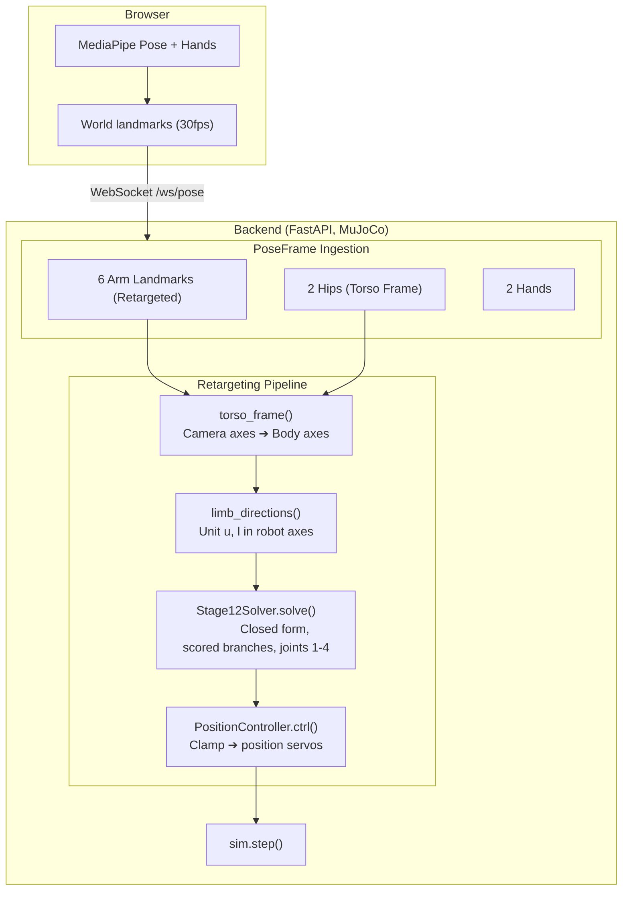

# Webcam to Bimanual Arm Human Pose Retargeting

Track human pose using webcam and drive a bimanual OpenArm in MuJoCo in real time. 

The browser runs MediaPipe and streams landmarks over a websocket; the backend holds one shared MuJoCo sim, retargets each frame to joint targets, and simulate steps.

## Solution

We represent the human limb vectors (upper arm, forarms and wrists) as unit vectors inferred from S-E-W coordinates (Shoulder, Elbow, Wrist) projected in Robot's torso frame. We then solve for maximum pose similarity by solving for robot joint angles with respect to the recorded limb vectors.

We primarily divide the problem into perception, retargeting, IK, filtering stages.

- **Perception**: Use RGB webcam and Mediapipe Posture + Hands to track Human pose. We use MediaPipe's **world** landmarks ([`socket.ts`](frontend/src/pose/socket.ts)), not the normalized image ones since those are divided by frame width and height separately, so on a 4:3 capture every direction taken from them is tilted toward vertical.
- **Retargeting**: We build a base frame (*torso frame*) from shoulders and hips, project both limb directions in it, and hand those to the robot as-is. Projecting the vectors in torso frame fixes the direction ambiguity, and enable estimation of depth. Working body-centric is what makes the result invariant to the operator turning or leaning ([`mapper.py`](backend/app/retarget/mapper.py)).
- **IK**: Closed-form [SEW-Mimic](https://arxiv.org/abs/2602.01632) stages 1-2 solve joints 1-4 directly without complex IK solvers ([`sew.py`](backend/app/retarget/sew.py)). We also evaluate damped least squares on the end-effector site, which can be experimented with using `RETARGET_MODE=ik` ([`ik.py`](backend/app/retarget/ik.py)).
- **Filtering**: The two shoulder rolls stop being observable at the singularities, i.e. arm straight, or raised out to the side - so each measured angle is weighted by how observable it is and unobservable ones relax toward the rest posture rather than tracking noise. Joints 5-7 hold neutral until stage 3 lands.

Why orientation based approach:
- Invariant to teleoperator's and robot's size. Directions are more robust to scale mismatch. OpenArm v2's upper arm to forearm ratio is 1:1.40 against a human's 1:0.78, so no scaling matches wrist *and* elbow position at once.
- Sew-Mimic provides closed-form IK solution that doesn't require Jacobian and doesn't suffer from numerical instabilities around singularities.
- Enables optimal geometric solution using [Paden-Kahan](https://en.wikipedia.org/wiki/Paden%E2%80%93Kahan_subproblems) subproblems.
- With orientation-based retargeting, relative depth can be estimated using limb length. Direction vector (Upper Arm and Forearm) along with the length magnitude gives wrist and elbow 3D position.

Why Mediapipe for landmark detection?
- Inexpensive, runs on browser with no additional hardware required.
- Reliable and versatile. A single solution can be used for Pose and Hand landmarks.

## Architecture



### Running

```bash
just install && just dev
```

`just dev` runs the backend with a MuJoCo viewer plus the Vite dev server; open the printed URL in a real browser, since it needs webcam access.

`just check` runs everything verifiable without a camera: the closed form against MuJoCo forward kinematics, the wired-up path against synthetic landmarks (accuracy, continuity through both singularities, torso invariance, steadiness under landmark noise), and the hand frame against its own symmetries.

### Demo view

```bash
just demo   # then open http://localhost:5173/demo.html
```

A second page, for showing the system rather than operating it: the sim on the left, the world landmarks driving it on the right, and no webcam beyond a small inset. Both halves are drawn into one 1280x720 canvas, and **Record** captures that canvas straight to a `.webm` — so the clip needs no screen-recording tool and doesn't depend on how the windows happened to be arranged.

The sim half is rendered offscreen by the backend ([`renderer.py`](backend/app/sim/renderer.py)) and streamed as JPEG frames over `/ws/sim`, rather than being the native viewer window. Only a page that owns both halves can composite and record them together. The renderer thread starts when the first client connects and stops when the last one leaves, so `just backend` alone costs nothing extra. Framing is env-tunable (`SIM_CAM_AZIMUTH`, `SIM_CAM_DISTANCE`, `SIM_RENDER_FPS`, …).

The pose half ([`skeleton3d.ts`](frontend/src/pose/skeleton3d.ts)) draws the **world** landmarks in perspective, not the image-space overlay `index.html` uses. Those are what the retargeter actually consumes, and they carry the depth the image overlay throws away — drag the pane to orbit and the z axis, the one a single webcam estimates worst, becomes something you can look at directly. The torso frame is drawn as a triad at the hip origin: it turns with the operator, which is the reason the retarget survives them turning or leaning.

The HUD's *singularity margin* is the solver's own observability weight (`Branch.trust`), not a separate estimate. It falls to zero exactly where a shoulder angle stops being determined by the pose — arm straight, or raised out to the side — which is where an iterative IK would be thrashing and where [`sew.py`](backend/app/retarget/sew.py) instead relaxes toward rest.

| Flag | Effect |
| --- | --- |
| `?synthetic=1` | Drive everything from a generated pose. No camera and no models, but the same landmarks down the same socket, so the robot still moves — for checking framing and recording without being in shot. |
| `?hands=0` | Pose model only, no hand landmarks. |

## Improvements

**Sew-Mimic**
- Wire SEW-Mimic stage 3 so joints 5-7 track wrist orientation. `mapper.hand_orientation()` already produces the input and logs it; nothing consumes it yet.

**Filtering** and **Smoothing**
- [1€ filter](https://gery.casiez.net/1euro/) to adaptively filter noisy input signals, or NN-based [N-euro](https://jianwang-cmu.github.io/23Neuro/N_euro_predictor.pdf) filter.
- Slew-limit and interpolate `qpos_target` between the 30fps pose stream and the 62.5Hz physics loop.

**Perception**
- We can use multiple monocular cameras to impart depth into the inputs or RGB-D cameras add natural depth to motion tracking.
- Other solutions include using [Neural networks](https://github.com/isarandi/nlf-pipeline) to estimate 3D pose and shape estimation, with the cost of additional latency.
- SMPL-family models output **joint rotations**, not just positions. Shoulder roll comes out directly, so no swivel inference, and no IK for the shoulder at all.

Other Retargeting solvers
- Keypoint-based retargeting
- Analytic Geometric IK Solvers

## Further Explorations

- Qin, Yuzhe, et al. "Anyteleop: A general vision-based dexterous robot arm-hand teleoperation system." arXiv preprint arXiv:2307.04577 (2023).
  - [GitHub - dexsuite/dex-retargeting: Various retargeting optimizers to translate human hand motion to robot hand motion. · GitHub](https://github.com/dexsuite/dex-retargeting)
- Chen, Zhenyang, et al. "WARP: Whole-Body Retargeting for Learning from Offline Human Demonstrations." arXiv preprint arXiv:2606.29940 (2026).
- [Humanoid Motion Retargeting - cuRobo](https://nvlabs.github.io/curobo/latest/getting-started/humanoid_retargeting.html)
- [GitHub - kevinzakka/mink: Python inverse kinematics based on MuJoCo. · GitHub](https://github.com/kevinzakka/mink)

## References

- [OpenArm](https://github.com/enactic/openarm_mujoco): the arm model, vendored as the `openarm_mujoco` submodule. v2 bimanual, 7 DoF plus a gripper per arm.
- [MediaPipe Pose Landmarker](https://ai.google.dev/edge/mediapipe/solutions/vision/pose_landmarker) and [Hand Landmarker](https://ai.google.dev/edge/mediapipe/solutions/vision/hand_landmarker)
- [MuJoCo documentation](https://mujoco.readthedocs.io/): `notes.md` has the terminology primer for the parts used here.
- Kong, Chuizheng, et al. "A Closed-Form Geometric Retargeting Solver for Upper Body Humanoid Robot Teleoperation." arXiv preprint arXiv:2602.01632 (2026). Sew-Mimic solver is used for retargeting pipeline.
